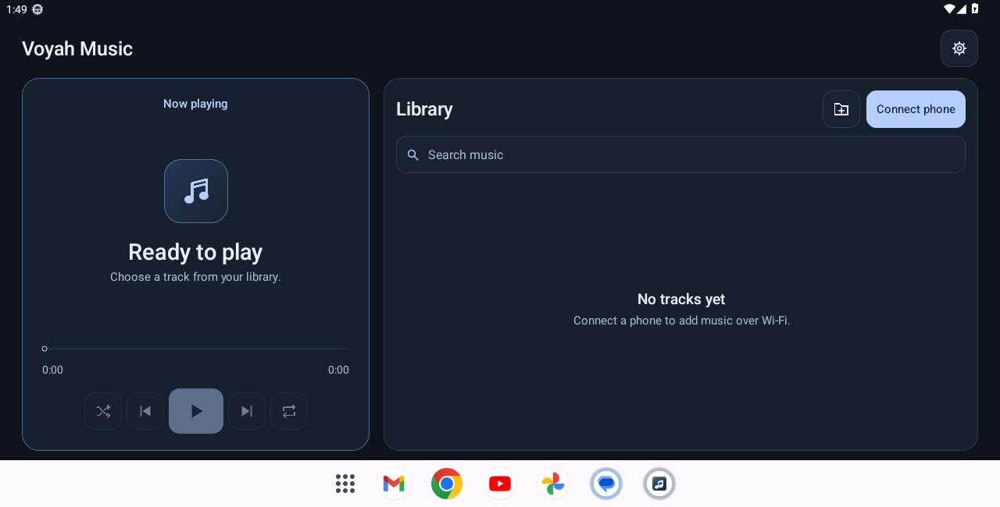
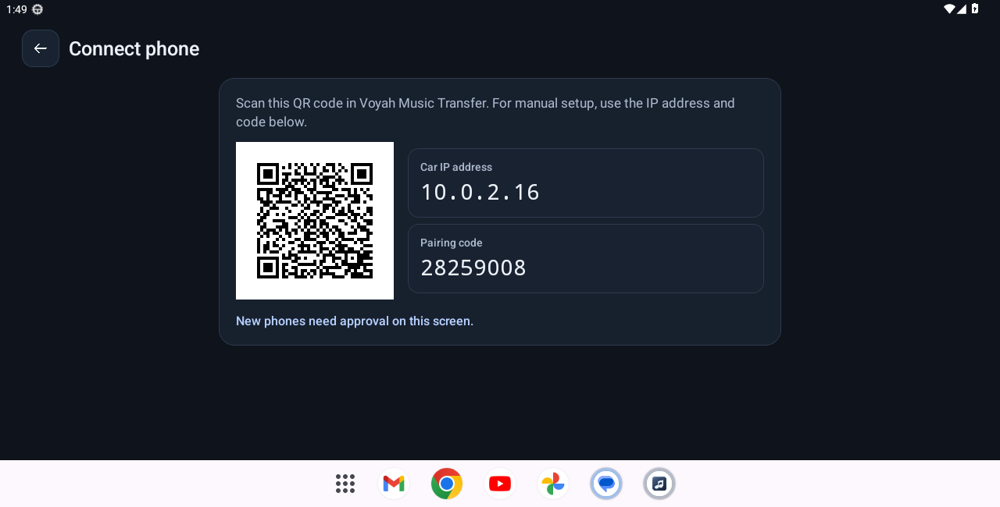

# Voyah Music

**Языки интерфейса:** русский, английский, казахский · [English README](README_EN.md)

Приложение-компаньон для [Open Voyah Controls](https://github.com/siarheisinelnikau/open-voyah-controls). **Voyah Music** играет музыку на экране автомобиля, а **Voyah Music Transfer** отправляет треки с Android-телефона.

- Подключите телефон по QR-коду и отправляйте музыку по Wi-Fi.
- Собирайте треки по папкам и ищите по названию, исполнителю или альбому.
- Слушайте сохранённую музыку офлайн и управляйте воспроизведением в фоне.




<p>
  
  
</p>



## Сборка

Для сборки нужны JDK 17 или новее и Android SDK 35. В одном модуле `:app` собираются два APK. У каждой версии приложения свой Activity.

```sh
./gradlew :app:assemblePlayerDebug :app:assembleTransferDebug
./gradlew :app:testPlayerDebugUnitTest :app:testTransferDebugUnitTest
```

Общий Kotlin-код передачи и обновлений находится в `app/src/main`. Экраны Compose, ViewModel и адаптеры автомобиля и телефона находятся в `app/src/player` и `app/src/transfer`.

## Протокол передачи

Текущая версия протокола — **2**. Она указана в QR-коде и заголовке каждого запроса. Формат запросов и данные сопряжения версии 2 остаются совместимыми с предыдущими сборками. Автомобиль отклоняет неподдерживаемую версию до обработки файла. Телефон отдельно сообщает о несовместимости, если видит такую версию в QR-коде или получает соответствующий ответ от автомобиля.

[GPLv3](LICENSE)
