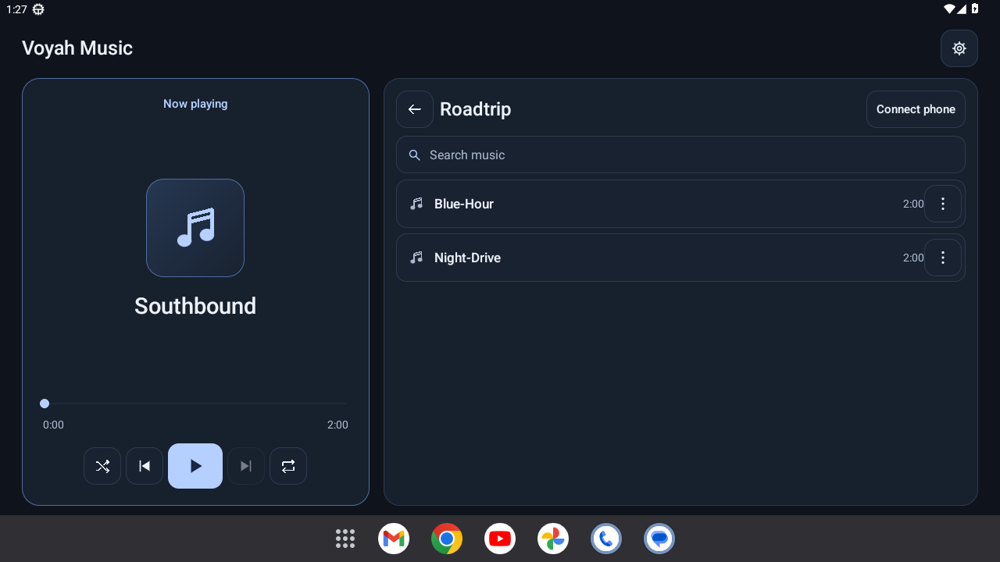
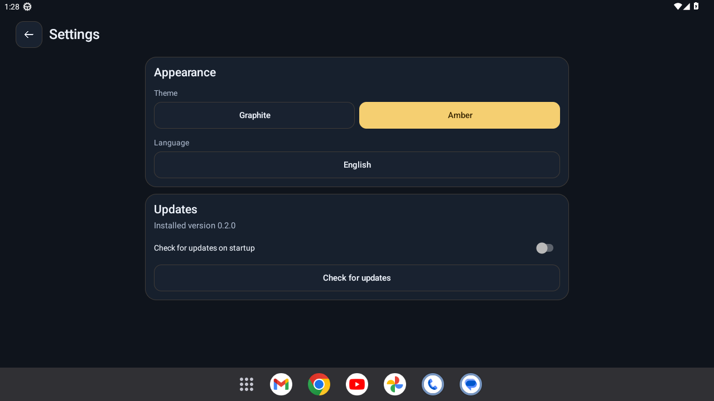
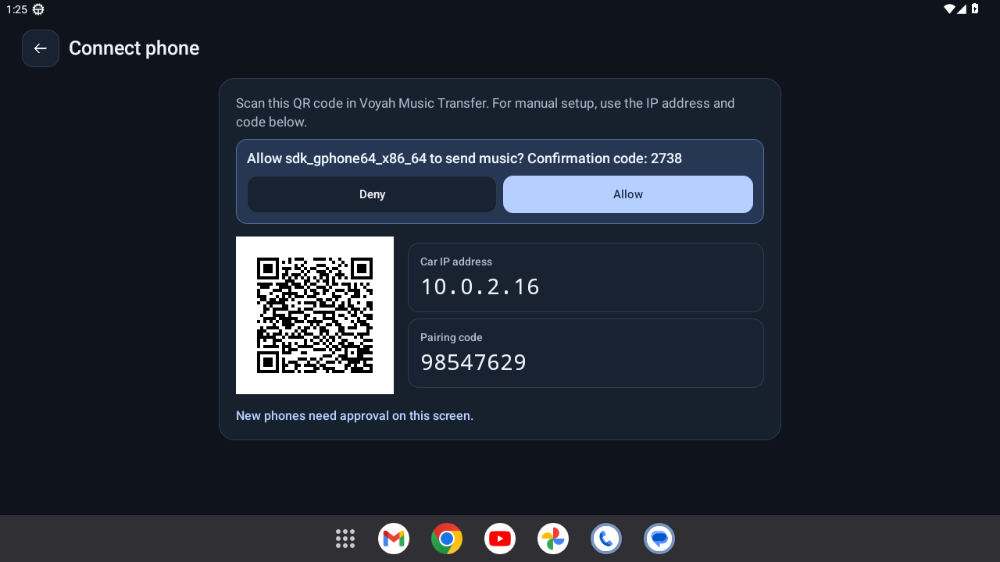
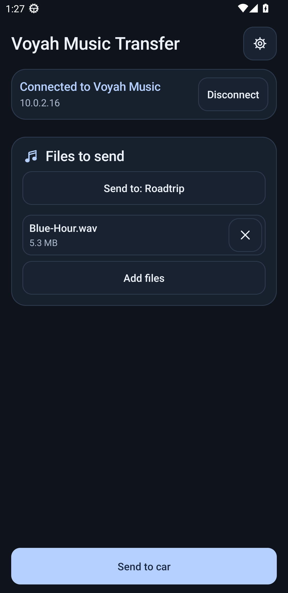
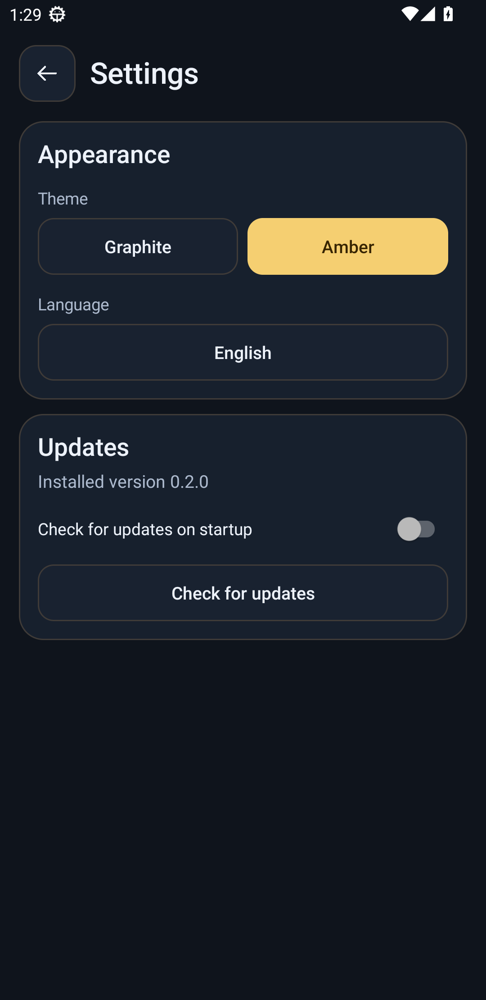

# Voyah Music

**Языки интерфейса:** русский, английский, казахский · [English README](README_EN.md)

Приложение-компаньон для [Open Voyah Controls](https://github.com/siarheisinelnikau/open-voyah-controls). **Voyah Music** играет музыку на экране автомобиля, а **Voyah Music Transfer** отправляет треки с Android-телефона.

- Подключите телефон по QR-коду и отправляйте музыку по Wi-Fi.
- Собирайте треки по папкам и ищите по названию, исполнителю или альбому.
- Слушайте сохранённую музыку офлайн и управляйте воспроизведением в фоне.

| Папки и треки | Настройки плеера |
| --- | --- |
|  |  |

| Подключение по QR | Подтверждение на экране автомобиля |
| --- | --- |
|  |  |

| Передача с телефона | Настройки на телефоне |
| --- | --- |
|  |  |

[GPLv3](LICENSE)
