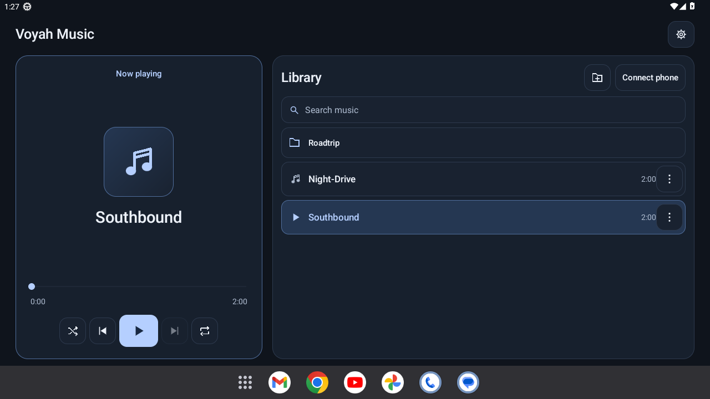
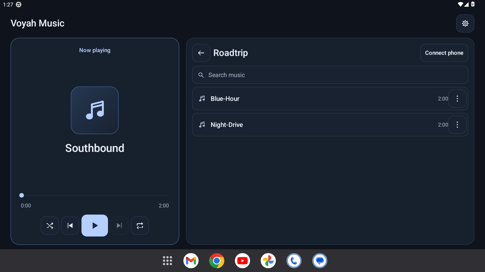
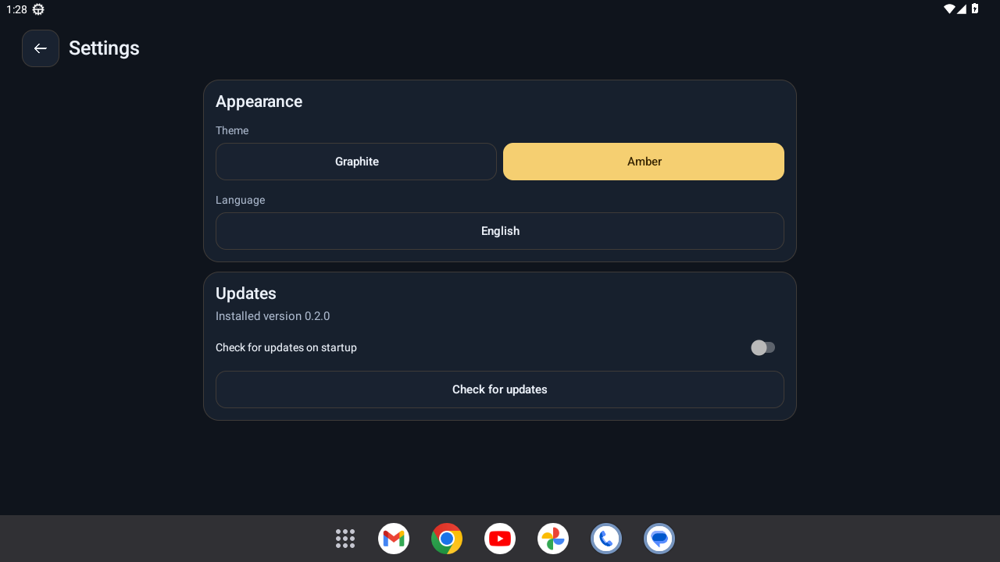
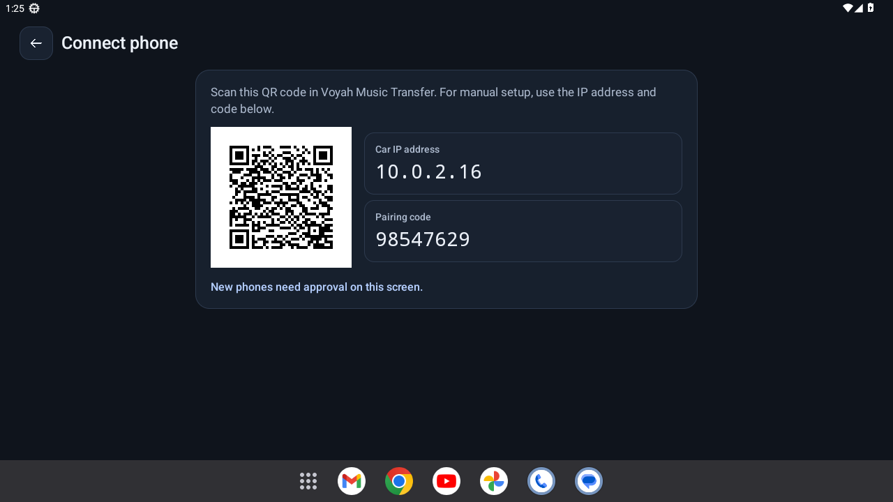
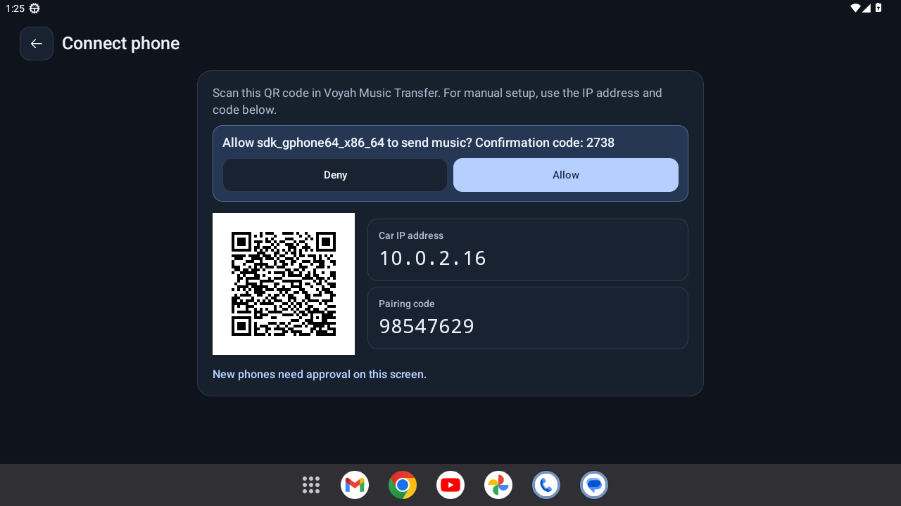
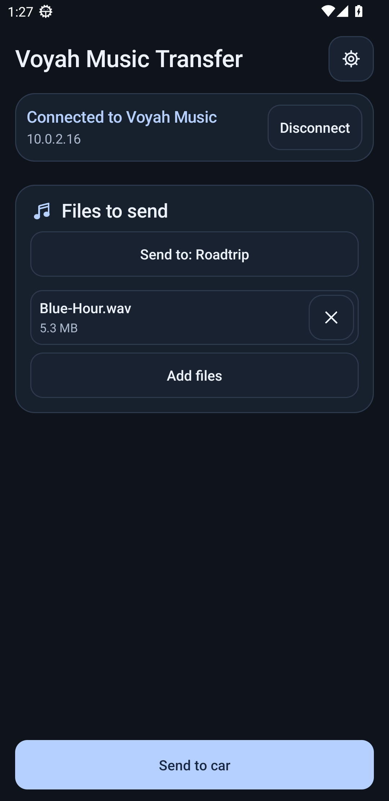
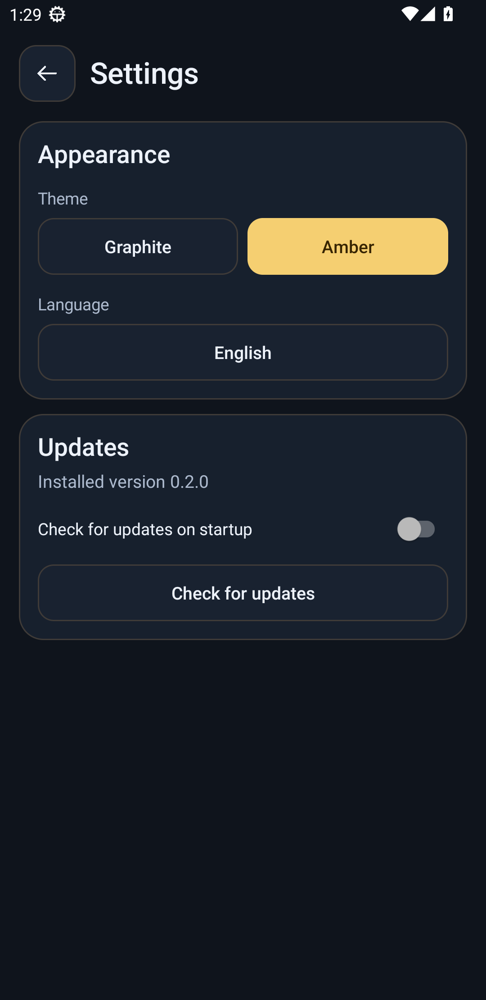

# Voyah Music

**Interface languages:** English, Russian, Kazakh · [Русский README](README.md)

A companion app for [Open Voyah Controls](https://github.com/siarheisinelnikau/open-voyah-controls). **Voyah Music** plays music on the car display, and **Voyah Music Transfer** sends tracks from an Android phone.

- Pair the phone with a QR code and send music over Wi-Fi.
- Organize tracks into folders and search by title, artist, or album.
- Listen to saved music offline and use system controls for background playback.

| Folders and tracks | Player settings |
| --- | --- |
|  |  |

| QR pairing | Confirmation on the car display |
| --- | --- |
|  |  |

| Phone transfer | Phone settings |
| --- | --- |
|  |  |

[GPLv3](LICENSE)
